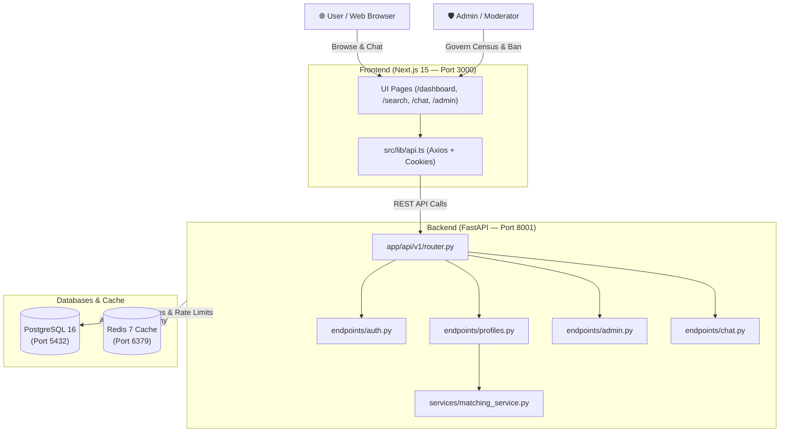

# Bandham Matrimonial Platform — Codebase Folder & Architecture Map

This document outlines the complete folder structure and file-by-file organization of the **Bandham Matrimonial Platform**. Use this map to navigate the codebase, understand component relationships, and locate specific functionality.

---

## 🏗️ Top-Level Overview

```text
bandhanmatrimony/
├── .github/workflows/       # Automated CI/CD workflows
├── backend/                 # FastAPI REST API, SQLAlchemy ORM, and matching engine
├── frontend/                # Next.js 15 App Router web application
├── docs/                    # Architectural specs, PRD, database ERD, security & deployment runbooks
├── tests/e2e/               # Playwright end-to-end browser integration tests
├── docker-compose.yml       # Production-identical multi-container development environment
└── README.md                # Project summary, feature matrix, and quickstart commands
```

---

## 1. ⚙️ Root Configuration & Orchestration

| File / Folder | Purpose & Responsibility |
| :--- | :--- |
| `docker-compose.yml` | Multi-service orchestration configuring 4 core containers: `bandhan_postgres` (PostgreSQL 16), `bandhan_redis` (Redis 7), `bandhan_backend` (FastAPI on port 8001), and `bandhan_frontend` (Next.js 15 on port 3000). |
| `railway.json` | Cloud deployment configuration for the Railway platform. |
| `README.md` | High-level architectural overview, tech stack documentation, test commands, and quickstart guide. |
| `.gitignore` | Prevents build artifacts (`node_modules/`, `.next/`, `.venv/`, `__pycache__/`, `.zip`) from polluting the git tree. |
| `.github/workflows/ci.yml` | GitHub Actions automated pipeline running linting, backend pytest test suites, frontend build verification, and end-to-end tests. |

---

## 2. 🐍 Backend Directory (`backend/`)

The backend is built with **Python 3.11+**, **FastAPI**, **SQLAlchemy 2.0 (Async)**, and **PostgreSQL 16**.

### Top-Level Backend Files & Directories
- `Dockerfile`: Multi-stage build creating an optimized, secure non-root Python runner image.
- `requirements.txt`: Python package manifest (`fastapi`, `uvicorn`, `sqlalchemy`, `pydantic`, `asyncpg`, `alembic`, `redis`, `bcrypt`, `pyjwt`, `faker`, `pytest`).
- `entrypoint.sh`: Automated container startup script that waits for PostgreSQL, applies Alembic migrations, runs database seeders, and starts Uvicorn.
- `alembic.ini` & `alembic/`: Schema migration environment, async connection hooks, and versioned database revision scripts.

### `backend/scripts/` (Database Seeding & Utilities)
- `seed_database.py`: Synthesizes 520+ high-fidelity Indian matrimonial profiles across diverse communities, educations, professions, and income brackets.
- `seed_rohan_demo.py`: Seeds **Rohan Kapoor** (`rohan@bandham.local`), links him as a mutual suitor to Ananya Sharma, and initiates an active live conversation with starter messages.
- `ensure_demo_coverage.py`: Verifies integrity of demo accounts and ensures required test fixtures are present.

### `backend/tests/` (Automated Test Suite)
- `conftest.py`: Pytest configuration, asynchronous test client fixtures, and ephemeral test database setup.
- `test_auth_and_api.py`: Comprehensive test suite verifying JWT token signing, OTP verification, access control boundaries, and security headers.
- `test_matching_engine.py`: Unit test suite testing the 7-vector weighted Euclidean and Jaccard matchmaking algorithm against edge cases.

### `backend/app/` (Application Source Code)

#### 1. `backend/app/core/` (Foundational Infrastructure)
- `config.py`: Centralized Pydantic `Settings` loading environment variables (`DATABASE_URL`, `REDIS_URL`, `JWT_SECRET`, token expiration times).
- `database.py`: SQLAlchemy 2.0 async engine creation, connection pooling, and `get_db` session generator.
- `redis.py`: Async Redis connection manager for session revocation, cache storage, and rate limiting.
- `security.py`: Password hashing using Bcrypt and JWT access/refresh token generation and verification.

#### 2. `backend/app/models/` (SQLAlchemy 2.0 ORM Entity Definitions)
- `base.py`: Shared `Base` declarative class and `TimestampMixin` (`created_at`, `updated_at`).
- `user.py`: `User` table (email, phone, hashed password, roles: `MEMBER`, `MODERATOR`, `ADMIN`, status: `ACTIVE`, `BANNED`, `SUSPENDED`).
- `profile.py`: `Profile` table (first name, age, height, education, occupation, community, gotra, manglik, bio, location, completeness percentage).
- `photo.py`: `ProfilePhoto` table (image keys, thumbnails, order, blur preferences).
- `preference.py`: `PartnerPreference` table (age range, height range, preferred religions, communities, and diets).
- `interaction.py`: `Interest` (invitation states: `PENDING`, `ACCEPTED`, `DECLINED`), `Shortlist` (bookmarks), and `ContactRequest` (two-way consent phone/email unlock).
- `chat.py`: `Conversation`, `ConversationParticipant`, and `ChatMessage` tables for 1-to-1 secure candidate messaging.
- `plan.py`: `Plan` and `UserSubscription` tables (Free, Silver, Gold tiers, contact credit balances).
- `safety.py`: `Report`, `Block`, and `ActivityLog` tables for trust, safety, and audit logging.

#### 3. `backend/app/schemas/` (Pydantic v2 Request & Response Data Contracts)
- `auth.py`: Validation schemas for Registration, Login, OTP verification, and JWT Token payloads.
- `profile.py`: `ProfileCreate`, `ProfileUpdate`, `ProfilePublicCard` (redacted), and `ProfileDetailResponse` (with pre-validators handling optional caste/community).
- `preference.py`: Partner preference filters and search criteria validation.
- `interaction.py`: Payloads for sending interests, updating interest status, and requesting contact reveals.
- `chat.py`: Chat message creation payloads, conversation previews, and message pagination models.
- `plan.py`: Membership plan tiers and credit transaction receipts.
- `safety.py`: Abuse reporting and disciplinary audit schemas.
- `admin.py`: User census listings, role modification requests (`UpdateUserRoleRequest`), and user status update requests (`UpdateUserStatusRequest`).

#### 4. `backend/app/api/v1/` (REST Endpoints & Routing)
- `deps.py`: Dependency injection providers (`get_db`, `get_current_user`, `require_admin_or_moderator`, `require_admin`).
- `router.py`: Central router registering all endpoint routers with `/api/v1` prefixes.
- `endpoints/auth.py`: `/auth/register`, `/auth/login`, `/auth/verify-otp`, `/auth/me`, `/auth/logout`.
- `endpoints/profiles.py`: `/profiles/me`, `/profiles/{id}`, `/profiles/search` (multi-faceted suitor filtering).
- `endpoints/matches.py`: `/matches/recommendations` (scores suitors with the 7-vector engine).
- `endpoints/interests.py`: `/interests/send`, `/interests/received`, `/interests/sent`, `/interests/{id}/respond`.
- `endpoints/shortlists.py`: `/shortlists` (bookmark candidate profiles).
- `endpoints/contacts.py`: `/contacts/request`, `/contacts/{id}/respond`, `/contacts/revealed` (two-party contact unlock).
- `endpoints/chat.py`: `/chat/conversations`, `/chat/conversations/{id}/messages` (1-to-1 messaging).
- `endpoints/plans.py`: `/plans`, `/plans/subscribe` (membership credits & tier upgrades).
- `endpoints/safety.py`: `/safety/report`, `/safety/block` (harassment prevention).
- `endpoints/privacy.py`: `/privacy/settings` (photo blur, phone privacy, and search visibility).
- `endpoints/preferences.py`: `/preferences` (manage desired suitor criteria).
- `endpoints/admin.py`: `/admin/users` (census), `/admin/users/{id}/role` (upgrade/degrade role), `/admin/users/{id}/status` (block/ban/suspend).

#### 5. `backend/app/services/` (Business Logic & Algorithms)
- `matching_service.py`: Implements the 7-vector weighted Euclidean and Jaccard matchmaking engine (calculating compatibility across Age, Religion/Caste, Education, Career/Income, Location, Diet/Habits, and Family Values).

---

## 3. 🌐 Frontend Directory (`frontend/`)

Built with **Next.js 15 (App Router)**, **React 19**, **TypeScript**, and **Tailwind CSS**.

### Top-Level Frontend Files
- `Dockerfile`: Multi-stage production Docker build running a standalone Next.js server on port 3000.
- `package.json`: Frontend dependencies (`next`, `react`, `react-dom`, `tailwindcss`, `lucide-react`, `axios`).
- `next.config.mjs`: Next.js configuration enabling standalone Docker deployment and remote image domains.
- `tailwind.config.js`: Custom matrimonial palette (Crimson `#8B0000`, Saffron Gold `#FF9933`, Emerald, Neutral Grays).
- `public/`: Brand logo, placeholder avatar images, and static graphics.

### `frontend/src/lib/` & `frontend/src/types/`
- `src/lib/api.ts`: Central Axios API client with automatic JWT token attachment, cookie credential sharing, and normalized error interception.
- `src/types/index.ts`: TypeScript type definitions matching backend models (`UserProfile`, `PublicProfile`, `Interest`, `Conversation`, `ChatMessage`, `AdminUserItem`).

### `frontend/src/components/` (Component Architecture)

#### 1. `components/ui/` (Design System Primitives)
- `Button.tsx`: Accessible button component supporting primary, secondary, danger, outline, and ghost variants with integrated loading states.
- `Badge.tsx`: Visual status indicators (Role, Subscription, Verification status).
- `LoadingSpinner.tsx`: Smooth SVG activity indicator for async states.
- `EmptyState.tsx`: Meaningful empty states for empty inboxes, zero search results, or empty shortlists.

#### 2. `components/layout/` (Global Navigation & Frame)
- `Header.tsx`: Responsive navigation bar showing brand identity, profile avatar, active conversation badges, and admin navigation.
- `Footer.tsx`: Footer with platform trust badges, privacy policy links, and regulatory statements.

#### 3. `components/profile/` (Matrimonial Profile Components)
- `ProfileCard.tsx`: Candidate summary card used in search and recommendation grids (renders photo blur status, prominent gender tag, age, height, education, occupation, location, and Quick Action buttons).
- `CompatibilityBadge.tsx`: Radial color-coded compatibility badge (High Match >80%, Moderate Match >60%).

### `frontend/src/app/` (Next.js 15 App Router Routes)

| Route Path | File Location | Purpose & User Journey |
| :--- | :--- | :--- |
| `/` | `app/page.tsx` | Platform landing page with hero banner, security highlights, and CTA buttons. |
| `/login` | `app/login/page.tsx` | Authentication screen featuring 1-click test buttons for **Ananya**, **Rohan**, **Admin**, and **Moderator**. |
| `/register` | `app/register/page.tsx` | Onboarding wizard collecting account credentials, phone verification, and initial profile details. |
| `/dashboard` | `app/dashboard/page.tsx` | Member dashboard showing profile completeness tracker, recent matches, and quick statistics. |
| `/search` | `app/search/page.tsx` | Multi-facet suitor search with religion, education, age, and location filters. |
| `/matches` | `app/matches/page.tsx` | Daily tailored recommendations calculated by the 7-vector matchmaking engine. |
| `/profile/[id]` | `app/profile/[id]/page.tsx` | Full candidate portfolio view with compatibility score breakdown, verified credentials, and contact unlock. |
| `/profile/edit` | `app/profile/edit/page.tsx` | Profile editor with optional caste/gotra/manglik fields and bio narrative safety validation. |
| `/inbox` | `app/inbox/page.tsx` | Asymmetric interest management tabbed by **Received Interests** and **Sent Interests**. |
| `/shortlist` | `app/shortlist/page.tsx` | Bookmarked profiles for future suitor consideration. |
| `/chat` | `app/chat/page.tsx` | Real-time 1-to-1 conversation view between mutually matched suitors. |
| `/pricing` | `app/pricing/page.tsx` | Transparent subscription tiers (Free, Silver, Gold) with credit balances and benefits comparison. |
| `/settings` | `app/settings/page.tsx` | Privacy controls: photo blur toggle, phone privacy mode, and account deactivation. |
| `/admin` | `app/admin/page.tsx` | Trust & Governance Center: **Member Census**, in-place **Role Governance** dropdowns (`MEMBER`/`MODERATOR`/`ADMIN`), and **Block/Suspend/Reactivate** enforcement. |

---

## 4. 📚 Documentation Directory (`docs/`)

The `docs/` folder contains the clean-room architectural specifications and design artifacts:

```text
docs/
├── analysis/                # Phase 1: Reverse-Engineering & Requirements Extraction
│   ├── 01_feature_inventory.md
│   ├── 02_user_journeys.md
│   ├── 03_sitemap_and_information_architecture.md
│   ├── 04_inferred_entities_and_business_rules.md
│   └── 05_reverse_engineering_synthesis.md
├── prd/                     # Phase 2: Product Requirements & RBAC
│   ├── 01_product_requirements_document.md
│   ├── 02_mvp_vs_v2_scope_matrix.md
│   └── 03_roles_permissions_rbac.md
├── database/                # Phase 3: Relational Design & Data Schema
│   └── 01_database_design_and_erd.md
├── matching/                # Phase 5: Algorithmic Matchmaking Specification
│   └── 01_matching_engine_spec_and_worked_example.md
├── security/                # Phase 7: Trust, Privacy, & OWASP Compliance
│   └── 01_security_privacy_owasp_compliance.md
├── deployment_guide.md      # Phase 8: Operations & Production Deployment Runbook
└── PROJECT_STRUCTURE.md     # This comprehensive folder & architecture guide
```

---

## 5. 🧪 End-to-End Tests (`tests/`)

- `tests/e2e/matrimonial_flow.spec.ts`: End-to-end browser tests using Playwright. Covers the complete user lifecycle: candidate registration -> profile completion -> suitor search -> interest proposal -> acceptance -> two-party contact reveal credit check.

---

## 🔄 How the Components Connect


