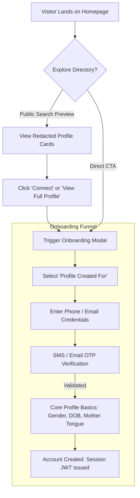
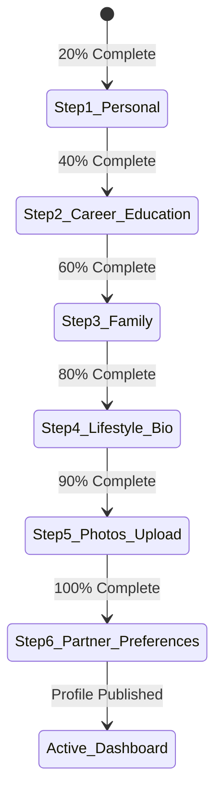
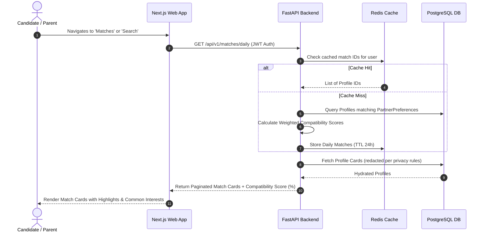
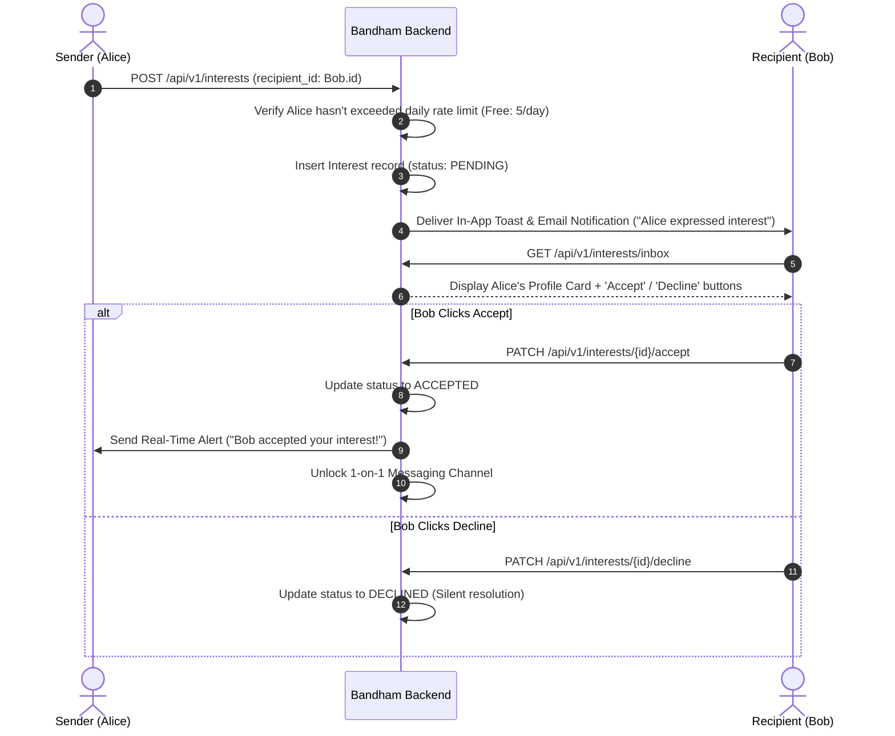
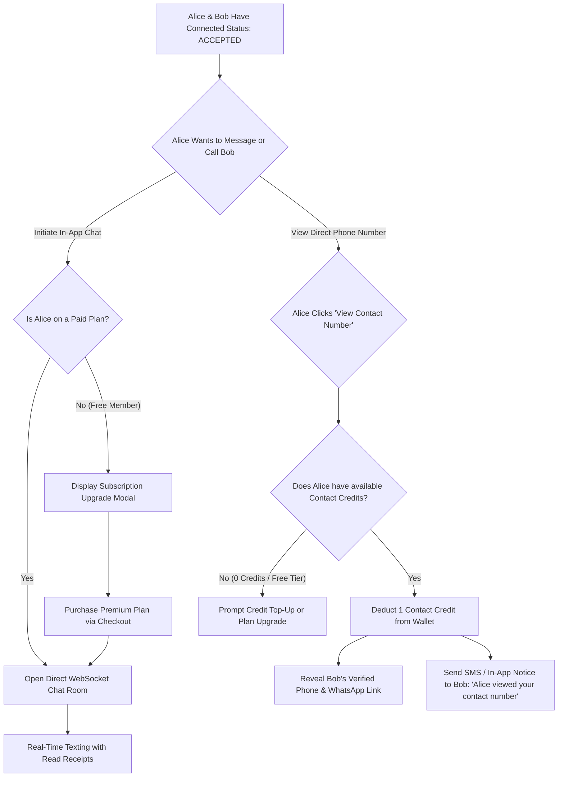
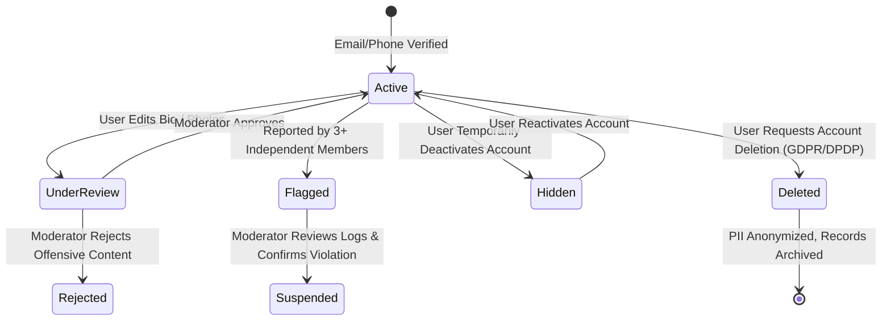

# User Journeys & Experience Architecture: Matrimonial Platform

> **REA Clean-Room Behavioral Analysis**: This document models the complete lifecycle and cognitive pathways of users interacting with the **Bandham** (`<APP_NAME>`) matrimonial ecosystem. It tracks emotional drivers, security checkpoints, friction gates, and monetization touchpoints from first landing to successful matrimony.

---

## 1. Visitor to Registered Member (Discovery & Onboarding)

### Stage 1: Public Discovery & Value Realization
1. **Entry Point**: Visitor arrives via organic search, referral, or brand campaign on the landing page.
2. **Value Hook**: Clear hero section emphasizing trust, privacy, verified community members, and success stories.
3. **Low-Commitment Exploration**: Visitor can perform a guest search (e.g., "Groom | 26-30 | Hindi | Software Engineer | Bangalore").
4. **Friction Gate**: Profile cards in guest search display silhouette avatars, masked names (`Ananya S.`), obscured contact details, and redacted family backgrounds.
5. **Conversion Trigger**: Clicking "View Full Profile", "Send Interest", or "Register Free" routes the user into the onboarding wizard.

### Stage 2: Registration & Dual-Channel OTP
1. **Step 1 - Creator Attribution**: User specifies `profile_for` (`Self`, `Son`, `Daughter`, `Brother`, `Sister`, `Friend`).
2. **Step 2 - Credentials**: User enters email, phone number, and password.
3. **Step 3 - Instant OTP Handshake**: A 6-digit cryptographic OTP is dispatched to the phone number. Upon entry, the phone status transitions to `VERIFIED`.
4. **Step 4 - Foundational Identity**: Captures Gender, Date of Birth, Mother Tongue, Religion, and Community.
5. **State Outcome**: A `User` record and draft `Profile` record are initialized. HttpOnly JWT cookies (`access_token`, `refresh_token`) are set.

---

## 2. Multi-Step Progressive Profiling (Completion Wizard)

Matrimonial profiles require comprehensive data; asking for 50 fields at once causes abandonment. We employ **Progressive Profiling** with visual progress indicators (25% -> 50% -> 75% -> 100%).

### Step-by-Step Breakdown

| Step | Section | Key Data Collected | Validation / Privacy Rules |
| :--- | :--- | :--- | :--- |
| **1** | **Personal & Physical** | Marital status, height, physical status, residing city, state, country, citizenship. | Height range validated (130cm–220cm). Age must satisfy legal marriage criteria. |
| **2** | **Education & Career** | Highest degree, college/university, employment sector, occupation, annual income bracket. | Income stored as discrete bracket enum to preserve privacy while supporting filters. |
| **3** | **Family Background** | Family type (nuclear/joint), family values, parents' status, siblings count. | Sensitive family data is accessible only to logged-in members. |
| **4** | **Lifestyle & Narrative** | Diet, smoking, drinking, hobbies, and free-form "About Me" narrative (min 100 chars). | Automated regex/filter strips phone numbers, emails, and external hyperlinks from bio. |
| **5** | **Photo Gallery** | Minimum 1 profile photo (up to 10 photos). Visibility settings configured. | Upload processed via S3/MinIO. Image sanitized, EXIF stripped, and WebP converted. |
| **6** | **Partner Expectations** | Desired age range, height range, preferred religions, communities, education, and location. | Forms the baseline vector for the matching recommendation algorithm. |

---

## 3. Search, Discovery & Recommendation Journey

### Discovery Modalities
1. **Daily Recommendations**: Pre-computed top 20 compatible candidates delivered every morning.
2. **Mutual Matches**: Profiles where both parties mutually satisfy each other's partner criteria.
3. **Faceted Filter Search**: Real-time multi-select filtering across age sliders, height sliders, communities, income brackets, and education levels.
4. **Saved Searches**: Ability to persist custom filter combinations and receive email/push alerts when new matching profiles register.

---

## 4. Interest & Connection Journey (Asymmetric Intent Funnel)

---

## 5. Communication & Contact Reveal Journey (Monetization Gate)

### Contact Privacy & Security Controls
1. **Audit Trail**: Every contact view is permanently recorded in `contact_views` with timestamp, viewer ID, profile ID, and IP hash.
2. **Anti-Scraping Quotas**: Even premium subscribers cannot bulk-reveal contacts; capped at a hard daily ceiling (e.g., max 15 reveals per 24-hour window) to block commercial database harvesting.
3. **Mutual Consent Settings**: Members can set their contact privacy to "Allow only accepted connections to view my number".

---

## 6. Safety, Moderation & Account Lifecycle Journey

1. **User-Initiated Safety**:
   - **Block**: Instantly severs all visibility, removes previous chats, hides both profiles from each other's search results.
   - **Report**: Opens a modal with categories (`Harassment`, `Fake Profile`, `Money Request / Fraud`, `Inappropriate Photos`). Attaches recent chat transcripts for moderator audit.
2. **Right to be Forgotten (Privacy Compliance)**:
   - User can download a complete JSON archive of their profile data, sent interests, and chats.
   - User can trigger permanent deletion: profile photos deleted from S3/MinIO, PII masked, phone/email hashed to prevent repeat abuse, and active subscriptions terminated.
