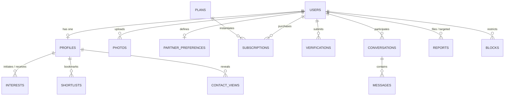
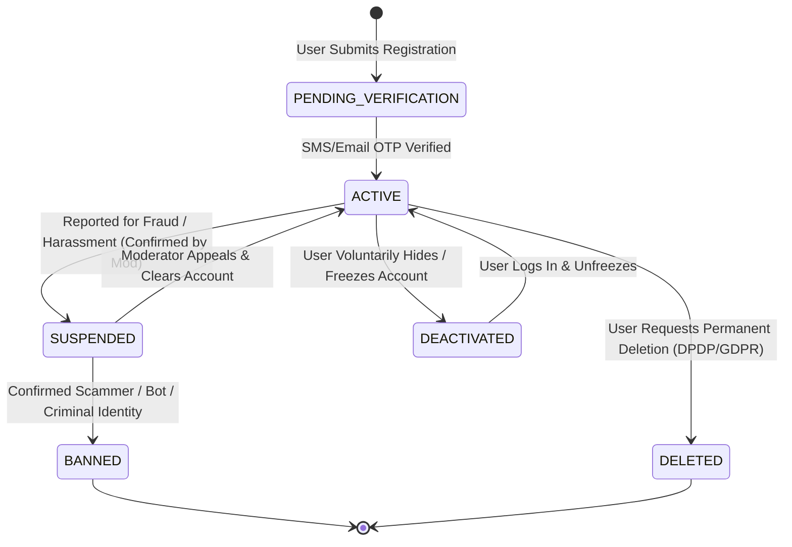
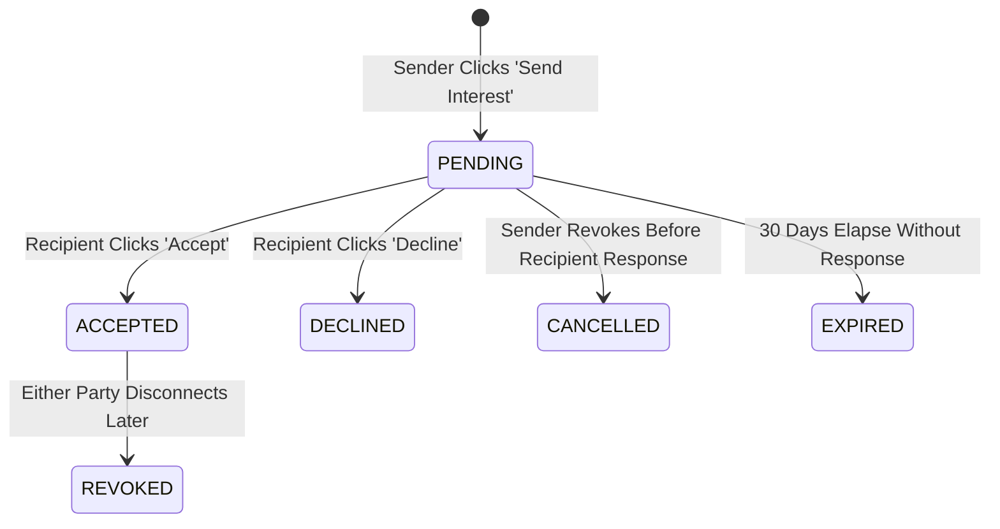

# Inferred Entities & Business Rules: Bandham Matrimonial Platform

> **REA Behavioral Architecture**: This document defines the domain entity relationships, state machines, lifecycle transitions, and business rule enforcement matrix deduced from real-world matrimonial platform mechanics.

---

## 1. Domain Entities & Conceptual Schema

### 1.1 Inferred Entity Definitions

1. **`User` (Account & Security Principal)**
   - `id`: UUID (Primary Key)
   - `email`: VARCHAR(255) Unique, Indexed
   - `phone_number`: VARCHAR(20) Unique, Indexed
   - `password_hash`: VARCHAR(255) (Argon2id / bcrypt)
   - `role`: ENUM (`MEMBER`, `MODERATOR`, `ADMIN`)
   - `status`: ENUM (`PENDING_VERIFICATION`, `ACTIVE`, `SUSPENDED`, `DEACTIVATED`)
   - `email_verified`: BOOLEAN
   - `phone_verified`: BOOLEAN
   - `created_at`, `updated_at`, `last_login_at`: TIMESTAMP

2. **`Profile` (Public/Protected Matrimonial Identity)**
   - `id`: UUID (Primary Key)
   - `user_id`: UUID Foreign Key -> `users.id` (Unique, 1-to-1)
   - `profile_id_display`: VARCHAR(16) Unique (e.g., `BDN-89234`)
   - `created_by`: ENUM (`SELF`, `PARENT`, `SIBLING`, `RELATIVE`, `FRIEND`)
   - `first_name`: VARCHAR(100)
   - `last_name`: VARCHAR(100)
   - `gender`: ENUM (`MALE`, `FEMALE`, `OTHER`)
   - `date_of_birth`: DATE (Must satisfy minimum age requirements)
   - `height_cm`: INTEGER (130 to 220)
   - `marital_status`: ENUM (`NEVER_MARRIED`, `DIVORCED`, `WIDOWED`, `AWAITING_DIVORCE`)
   - `religion`: VARCHAR(64) Indexed
   - `mother_tongue`: VARCHAR(64) Indexed
   - `community`: VARCHAR(64) Indexed
   - `sub_community`: VARCHAR(64)
   - `gotra`: VARCHAR(64)
   - `manglik`: ENUM (`YES`, `NO`, `DON'T_KNOW`, `ANGSHIK`)
   - `highest_education`: VARCHAR(128)
   - `education_field`: VARCHAR(128)
   - `college_name`: VARCHAR(255)
   - `employment_sector`: ENUM (`PRIVATE`, `GOVERNMENT`, `DEFENSE`, `BUSINESS`, `SELF_EMPLOYED`, `NOT_WORKING`)
   - `occupation`: VARCHAR(128)
   - `annual_income_bracket`: VARCHAR(64)
   - `residence_city`: VARCHAR(128) Indexed
   - `residence_state`: VARCHAR(128) Indexed
   - `residence_country`: VARCHAR(64) Indexed
   - `citizenship`: VARCHAR(64)
   - `family_type`: ENUM (`NUCLEAR`, `JOINT`)
   - `family_values`: ENUM (`TRADITIONAL`, `MODERATE`, `LIBERAL`)
   - `diet`: ENUM (`VEGETARIAN`, `NON_VEGETARIAN`, `EGGETARIAN`, `VEGAN`, `JAIN`)
   - `smoking`: ENUM (`NO`, `OCCASIONALLY`, `YES`)
   - `drinking`: ENUM (`NO`, `OCCASIONALLY`, `YES`)
   - `bio_narrative`: TEXT (Sanitized free-text, min 100 chars)
   - `profile_completeness_pct`: INTEGER (0-100)
   - `is_searchable`: BOOLEAN Default TRUE

3. **`PartnerPreference` (Matching Vector Bounds)**
   - `id`: UUID (Primary Key)
   - `user_id`: UUID Foreign Key -> `users.id` (Unique, 1-to-1)
   - `min_age`, `max_age`: INTEGER
   - `min_height_cm`, `max_height_cm`: INTEGER
   - `acceptable_marital_statuses`: JSONB / Array of Enums
   - `acceptable_religions`: JSONB / Array of Strings
   - `acceptable_communities`: JSONB / Array of Strings
   - `acceptable_mother_tongues`: JSONB / Array of Strings
   - `acceptable_countries`: JSONB / Array of Strings
   - `acceptable_cities`: JSONB / Array of Strings
   - `min_education_level`: VARCHAR(64)
   - `acceptable_employment_sectors`: JSONB / Array of Strings
   - `min_income_bracket`: VARCHAR(64)
   - `acceptable_diets`: JSONB / Array of Strings
   - `manglik_preference`: ENUM (`STRICT_MATCH`, `DOES_NOT_MATTER`)

4. **`Photo` (Media Assets)**
   - `id`: UUID (Primary Key)
   - `user_id`: UUID Foreign Key -> `users.id`
   - `s3_key_original`: VARCHAR(512)
   - `s3_key_thumbnail`: VARCHAR(512)
   - `s3_key_watermarked`: VARCHAR(512)
   - `is_primary`: BOOLEAN
   - `is_approved`: BOOLEAN Default FALSE (Requires moderation)
   - `visibility_mode`: ENUM (`PUBLIC`, `MEMBERS_ONLY`, `ACCEPTED_ONLY`, `ON_REQUEST`)
   - `sort_order`: INTEGER

5. **`Interest` (Connection Handshake)**
   - `id`: UUID (Primary Key)
   - `sender_id`: UUID Foreign Key -> `users.id`
   - `recipient_id`: UUID Foreign Key -> `users.id`
   - `status`: ENUM (`PENDING`, `ACCEPTED`, `DECLINED`, `CANCELLED`)
   - `greeting_message`: VARCHAR(255)
   - `created_at`, `updated_at`: TIMESTAMP
   - Constraint: Unique `(sender_id, recipient_id)`

6. **`Shortlist` (Private Bookmark)**
   - `id`: UUID (Primary Key)
   - `user_id`: UUID Foreign Key -> `users.id`
   - `shortlisted_user_id`: UUID Foreign Key -> `users.id`
   - `notes`: VARCHAR(255) (Private notes by user)
   - `created_at`: TIMESTAMP
   - Constraint: Unique `(user_id, shortlisted_user_id)`

7. **`ContactView` (Phone Reveal Audit Log)**
   - `id`: UUID (Primary Key)
   - `viewer_id`: UUID Foreign Key -> `users.id`
   - `target_user_id`: UUID Foreign Key -> `users.id`
   - `revealed_at`: TIMESTAMP
   - `ip_address`: VARCHAR(45)
   - Constraint: Unique `(viewer_id, target_user_id)` per billing cycle

8. **`Plan` & `Subscription` (Monetization)**
   - `Plan`: `id`, `name` (`FREE`, `GOLD`, `PLATINUM`, `DIAMOND`), `duration_months`, `price_cents`, `currency`, `contact_credits_quota`, `can_initiate_chat`, `can_view_hidden_photos`, `priority_boost`
   - `Subscription`: `id`, `user_id`, `plan_id`, `status` (`ACTIVE`, `EXPIRED`, `CANCELLED`), `starts_at`, `expires_at`, `contact_credits_remaining`

---

## 2. System State Machines

### 2.1 User Account State Machine

### 2.2 Express Interest Lifecycle

---

## 3. Free vs. Paid Business Rules Matrix

| Capability / Boundary | Free Tier ("Explorer") | Gold Tier | Platinum / Diamond Tier |
| :--- | :--- | :--- | :--- |
| **Profile Creation & Photos** | Up to 10 photos, full profile builder | Up to 10 photos, priority approval queue | Up to 10 photos, instant VIP moderation |
| **Daily Interests Limit** | **5 interests / 24 hours** (Anti-spam rate limit) | **Unlimited interests** | **Unlimited interests** + Spotlight message attachment |
| **Direct Contact Reveals** | **0** (Phone & Email masked) | **50 Verified Contact Reveals** / subscription cycle | **150+ Verified Contact Reveals** / subscription cycle |
| **In-App Messaging Initiation** | **Cannot initiate**. Can only reply if initiated by a Paid member or if mutual interest accepted | **Can initiate chat** with any accepted connection | **Can initiate direct chat** with any registered member |
| **Message Read Receipts** | Unavailable | Standard sent/delivered status | **Real-time Read Receipts** (ticks turn blue with timestamp) |
| **Photo Privacy Controls** | Standard visibility options | Can view blurred photos of users who allow verified/paid members | Priority access to photo unlock requests |
| **Search & Filtering Depth** | Basic demographic search (Age, Height, Religion, City) | Advanced faceted filters (Income, Occupation, Education field) | Advanced filters + "Verified Income" & "High Compatibility" filters |
| **Recommendation Ranking** | Standard chronological & compatibility score | **2x Search Rank Boost** (Higher placement in query results) | **5x Search Rank Boost** + Top placement in "Today's Matches" |
| **Profile Views Tracker** | Counts only (e.g., "14 members viewed you") | See exactly who viewed your profile with timestamps | Full viewer dossier + alert when someone views your phone number |
| **Customer Assistance** | Community / Email support (48h SLA) | Priority email & chat support (12h SLA) | Dedicated Relationship Advisor & Phone support |
