# Database Architecture, ERD & Normalization: Bandham Matrimonial Platform

> **Relational Data Engineering Specification**: Matrimonial applications represent read-heavy, multi-attribute relational databases with strict integrity, privacy isolation, and high-dimensional search indexing. This document details the PostgreSQL 16 schema, normal forms, constraints, and indexing strategy.

---

## 1. Entity-Relationship Diagram (ERD)

```mermaid
erDiagram
    USERS ||--|| PROFILES : "has one"
    USERS ||--|| PARTNER_PREFERENCES : "configures"
    USERS ||--o{ PHOTOS : "uploads"
    USERS ||--o{ SUBSCRIPTIONS : "maintains"
    USERS ||--o{ VERIFICATIONS : "submits"
    USERS ||--o{ NOTIFICATIONS : "receives"
    USERS ||--o{ AUDIT_LOGS : "triggers"
    
    PROFILES ||--o{ INTERESTS : "sends (as sender)"
    PROFILES ||--o{ INTERESTS : "receives (as recipient)"
    PROFILES ||--o{ SHORTLISTS : "bookmarks (as user)"
    PROFILES ||--o{ SHORTLISTS : "targeted (as candidate)"
    PROFILES ||--o{ CONTACT_VIEWS : "views"
    PROFILES ||--o{ CONTACT_VIEWS : "unlocked"
    
    USERS ||--o{ CONVERSATION_PARTICIPANTS : "joins"
    CONVERSATIONS ||--o{ CONVERSATION_PARTICIPANTS : "includes"
    CONVERSATIONS ||--o{ MESSAGES : "contains"
    USERS ||--o{ MESSAGES : "authors"
    
    USERS ||--o{ BLOCKS : "blocks (blocker)"
    USERS ||--o{ BLOCKS : "blocked (blocked_user)"
    USERS ||--o{ REPORTS : "files (reporter)"
    USERS ||--o{ REPORTS : "reported (reported_user)"
    
    PLANS ||--o{ SUBSCRIPTIONS : "defines"
    SUBSCRIPTIONS ||--o{ PAYMENTS : "billed_by"

    USERS {
        uuid id PK
        varchar email UK
        varchar phone_number UK
        varchar password_hash
        enum role "MEMBER, MODERATOR, ADMIN"
        enum status "PENDING_VERIFICATION, ACTIVE, SUSPENDED, DEACTIVATED, BANNED"
        boolean email_verified
        boolean phone_verified
        timestamp created_at
        timestamp updated_at
        timestamp last_login_at
    }

    PROFILES {
        uuid id PK
        uuid user_id FK,UK
        varchar profile_id_display UK "e.g. BDN-84920"
        enum created_by "SELF, PARENT, SIBLING, RELATIVE, FRIEND"
        varchar first_name
        varchar last_name
        enum gender "MALE, FEMALE, OTHER"
        date date_of_birth
        integer height_cm
        enum marital_status "NEVER_MARRIED, DIVORCED, WIDOWED, AWAITING_DIVORCE"
        varchar religion
        varchar mother_tongue
        varchar community
        varchar sub_community
        varchar gotra
        enum manglik "YES, NO, DONT_KNOW, ANGSHIK"
        varchar highest_education
        varchar education_field
        varchar college_name
        enum employment_sector "PRIVATE, GOVERNMENT, DEFENSE, BUSINESS, SELF_EMPLOYED, NOT_WORKING"
        varchar occupation
        varchar annual_income_bracket
        varchar residence_city
        varchar residence_state
        varchar residence_country
        varchar citizenship
        enum family_type "NUCLEAR, JOINT"
        enum family_values "TRADITIONAL, MODERATE, LIBERAL"
        enum diet "VEGETARIAN, NON_VEGETARIAN, EGGETARIAN, VEGAN, JAIN"
        enum smoking "NO, OCCASIONALLY, YES"
        enum drinking "NO, OCCASIONALLY, YES"
        text bio_narrative
        integer profile_completeness_pct
        boolean is_searchable
        timestamp created_at
        timestamp updated_at
    }

    PARTNER_PREFERENCES {
        uuid id PK
        uuid user_id FK,UK
        integer min_age
        integer max_age
        integer min_height_cm
        integer max_height_cm
        jsonb acceptable_marital_statuses
        jsonb acceptable_religions
        jsonb acceptable_communities
        jsonb acceptable_mother_tongues
        jsonb acceptable_countries
        jsonb acceptable_cities
        varchar min_education_level
        jsonb acceptable_employment_sectors
        varchar min_income_bracket
        jsonb acceptable_diets
        enum manglik_preference "STRICT_MATCH, DOES_NOT_MATTER"
        timestamp updated_at
    }

    PHOTOS {
        uuid id PK
        uuid user_id FK
        varchar s3_key_original
        varchar s3_key_thumbnail
        varchar s3_key_watermarked
        boolean is_primary
        boolean is_approved
        enum visibility_mode "PUBLIC, MEMBERS_ONLY, ACCEPTED_ONLY, ON_REQUEST"
        integer sort_order
        timestamp created_at
    }

    INTERESTS {
        uuid id PK
        uuid sender_id FK
        uuid recipient_id FK
        enum status "PENDING, ACCEPTED, DECLINED, CANCELLED, EXPIRED"
        varchar greeting_message
        timestamp created_at
        timestamp updated_at
    }

    SHORTLISTS {
        uuid id PK
        uuid user_id FK
        uuid shortlisted_user_id FK
        varchar notes
        timestamp created_at
    }

    CONTACT_VIEWS {
        uuid id PK
        uuid viewer_id FK
        uuid target_user_id FK
        timestamp revealed_at
        varchar ip_address
    }

    CONVERSATIONS {
        uuid id PK
        timestamp created_at
        timestamp updated_at
    }

    CONVERSATION_PARTICIPANTS {
        uuid conversation_id FK
        uuid user_id FK
        timestamp joined_at
        timestamp last_read_at
    }

    MESSAGES {
        uuid id PK
        uuid conversation_id FK
        uuid sender_id FK
        text content
        enum status "SENT, DELIVERED, READ"
        timestamp created_at
    }

    PLANS {
        uuid id PK
        varchar name UK "FREE, GOLD, PLATINUM, DIAMOND"
        integer duration_months
        integer price_cents
        varchar currency
        integer contact_credits_quota
        boolean can_initiate_chat
        boolean can_view_hidden_photos
        integer priority_boost
        boolean is_active
    }

    SUBSCRIPTIONS {
        uuid id PK
        uuid user_id FK
        uuid plan_id FK
        enum status "ACTIVE, EXPIRED, CANCELLED"
        timestamp starts_at
        timestamp expires_at
        integer contact_credits_remaining
        timestamp created_at
    }

    PAYMENTS {
        uuid id PK
        uuid subscription_id FK
        uuid user_id FK
        integer amount_cents
        varchar currency
        varchar payment_gateway "STUB, STRIPE, RAZORPAY"
        varchar transaction_ref UK
        enum status "PENDING, COMPLETED, FAILED, REFUNDED"
        timestamp created_at
    }

    VERIFICATIONS {
        uuid id PK
        uuid user_id FK
        enum verification_type "GOVERNMENT_ID, SELFIE_LIVENESS, SALARY_SLIP"
        varchar document_s3_key
        enum status "PENDING, APPROVED, REJECTED"
        text rejection_reason
        uuid reviewed_by_id FK
        timestamp created_at
        timestamp reviewed_at
    }

    REPORTS {
        uuid id PK
        uuid reporter_id FK
        uuid reported_user_id FK
        enum category "FAKE_PROFILE, HARASSMENT, FINANCIAL_SCAM, MARRIED_FRAUD, INAPPROPRIATE_MEDIA"
        text description
        jsonb attached_chat_context
        enum status "PENDING, UNDER_REVIEW, RESOLVED, DISMISSED"
        uuid resolved_by_id FK
        timestamp created_at
        timestamp resolved_at
    }

    BLOCKS {
        uuid id PK
        uuid blocker_id FK
        uuid blocked_user_id FK
        timestamp created_at
    }

    NOTIFICATIONS {
        uuid id PK
        uuid user_id FK
        varchar title
        text message
        enum notification_type "INTEREST_RECEIVED, INTEREST_ACCEPTED, CONTACT_VIEWED, MESSAGE_RECEIVED, SYSTEM"
        varchar reference_link
        boolean is_read
        timestamp created_at
    }

    AUDIT_LOGS {
        uuid id PK
        uuid actor_id FK
        varchar action
        varchar resource_type
        varchar resource_id
        varchar ip_address
        jsonb metadata
        timestamp created_at
    }
```



---

## 2. Normalization Analysis & Engineering Trade-Offs

### 2.1 First Normal Form (1NF)
- Every table has a distinct primary key (UUID v4).
- Every column contains atomic values. Multivalued user criteria (such as acceptable religions in `partner_preferences`) are stored in structured JSONB arrays backed by GIN indexes rather than delimiter-separated strings, preserving relational atomicity while supporting array queries.

### 2.2 Second Normal Form (2NF)
- All non-key attributes are fully functionally dependent on the primary key.
- Composite join tables like `conversation_participants` have attributes (`joined_at`, `last_read_at`) that depend on the full composite key `(conversation_id, user_id)`.

### 2.3 Third Normal Form (3NF) & Boyce-Codd Normal Form (BCNF)
- No transitive dependencies exist. For example, `subscription_id` is linked to `plan_id`, but plan prices and quota attributes reside exclusively in `plans`, preventing update anomalies if plan costs change over time.
- Historical billing amounts are preserved in `payments.amount_cents` to prevent retrospective alterations to financial ledgers.

### 2.4 Intentional Denormalization Trade-Offs
1. **`profiles.profile_completeness_pct`**: Computing completeness requires inspecting ~30 columns across 5 logical categories. Recalculating this on every search query would degrade search performance. It is stored as an integer and recomputed only on profile write (`PUT /profiles/me`).
2. **`subscriptions.contact_credits_remaining`**: Storing remaining credits directly on the active subscription row enables fast atomic decrements:
   ```sql
   UPDATE subscriptions 
   SET contact_credits_remaining = contact_credits_remaining - 1 
   WHERE id = :id AND contact_credits_remaining > 0;
   ```
   This eliminates the need to execute an expensive aggregate `COUNT(*)` over the `contact_views` audit table on every profile view.

---

## 3. Indexing Strategy & Performance Engineering

```sql
-- 1. Trigram fuzzy text index on Profile Bio and Occupation
CREATE EXTENSION IF NOT EXISTS pg_trgm;
CREATE INDEX idx_profiles_bio_trgm ON profiles USING gin (bio_narrative gin_trgm_ops);
CREATE INDEX idx_profiles_occupation_trgm ON profiles USING gin (occupation gin_trgm_ops);

-- 2. B-Tree Multi-Column Index for Core Faceted Search Queries
CREATE INDEX idx_profiles_search_core ON profiles (
    gender, 
    marital_status, 
    religion, 
    mother_tongue, 
    residence_country, 
    residence_city
);

-- 3. Range Indexes for Numeric Sliders (Age / Height)
CREATE INDEX idx_profiles_dob_height ON profiles (date_of_birth, height_cm);

-- 4. JSONB Array Index for Partner Preferences
CREATE INDEX idx_partner_pref_religions ON partner_preferences USING gin (acceptable_religions);
CREATE INDEX idx_partner_pref_communities ON partner_preferences USING gin (acceptable_communities);
CREATE INDEX idx_partner_pref_cities ON partner_preferences USING gin (acceptable_cities);

-- 5. Composite Unique Constraints to Prevent Duplicate State
ALTER TABLE interests ADD CONSTRAINT uq_interests_sender_recipient UNIQUE (sender_id, recipient_id);
ALTER TABLE shortlists ADD CONSTRAINT uq_shortlists_user_target UNIQUE (user_id, shortlisted_user_id);
ALTER TABLE blocks ADD CONSTRAINT uq_blocks_blocker_blocked UNIQUE (blocker_id, blocked_user_id);
ALTER TABLE conversation_participants ADD CONSTRAINT pk_conv_participants PRIMARY KEY (conversation_id, user_id);
```
