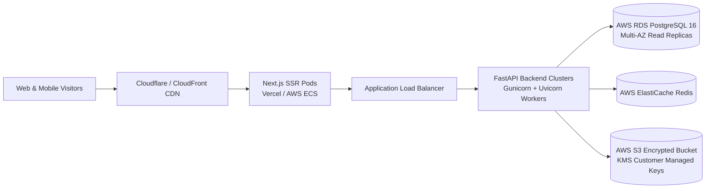

# Bandhan Matrimonial Platform: Operations & Deployment Guide

> **Production Engineering Handbook**: This manual covers local development startup, Docker Compose orchestration, database migrations, 500+ profile seeding, testing procedures, and cloud production deployment.

---

## 1. Local Development Quickstart

### Prerequisites
- Docker & Docker Compose v2+
- Python 3.11+
- Node.js 20+ & npm

### Method A: Single Command Startup via Docker Compose
To boot up the entire stack (PostgreSQL, Redis, MinIO, FastAPI Backend, and Next.js Frontend) in unified containers:

```bash
docker compose up -d
```

Check container health:
```bash
docker compose ps
```

- **Frontend Web UI**: http://localhost:3000
- **FastAPI Interactive Swagger Docs**: http://localhost:8000/api/v1/docs
- **MinIO Object Storage Console**: http://localhost:9001 (User: `minioadmin` / Pass: `minioadminpassword`)

---

## 2. Database Migration & 500+ Profile Seeding

### 2.1 Run Alembic Migrations
```bash
cd backend
alembic upgrade head
```

### 2.2 Populate 500+ Culturally Diverse Seed Profiles
Execute the high-fidelity Faker seed script:
```bash
PYTHONPATH=. python backend/scripts/seed_database.py
```
This generates:
- **Default Membership Plans**: `FREE`, `GOLD`, `PLATINUM`, `DIAMOND`.
- **Admin User**: `admin@bandhan.local` / `Admin@12345`
- **Moderator User**: `moderator@bandhan.local` / `Moderator@12345`
- **Primary Demo Candidate**: `ananya@bandhan.local` / `Ananya@12345` (Complete profile, Gold pass, sample incoming interests & chats).
- **520+ Diverse Profiles**: Multi-cultural demographic spread across major Indian communities, occupations, and cities.

---

## 3. Running Automated Tests

### 3.1 Backend Pytest Suite (Unit & API Integration)
```bash
PYTHONPATH=. pytest backend/tests -v
```

### 3.2 Frontend End-to-End Tests (Playwright)
```bash
npx playwright test tests/e2e
```

---

## 4. Production Cloud Deployment Architecture



### Production Checklist
1. **Rotate Secrets**: Set high-entropy `SECRET_KEY` and database passwords in production `.env`.
2. **Enable SSL/TLS**: Ensure `secure=True` on HttpOnly authentication cookies.
3. **Configure AWS S3**: Point `S3_ENDPOINT_URL` to AWS S3 and attach an IAM role with restricted bucket policy.
4. **Database Backups**: Enable automated daily snapshots and Point-in-Time Recovery (PITR) on PostgreSQL.
