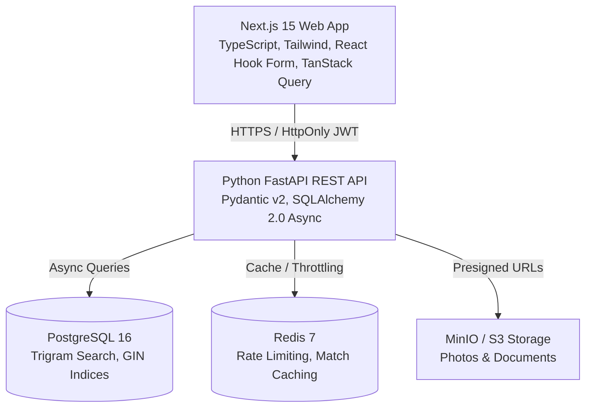

# Product Requirements Document (PRD): Bandham Matrimonial Platform

> **Document Status**: Approved Baseline  
> **Target Version**: v1.0.0 (MVP)  
> **Product Name**: Bandham (`<APP_NAME>`)  
> **Target Audience**: Marriage-minded individuals, parents, and families seeking culturally aligned life partners.

---

## 1. Executive Summary & Problem Statement

### 1.1 Problem Statement
Modern digital matchmaking presents a polarization problem:
1. **Casual Dating Apps (Tinder, Bumble, Hinge)** are swipe-centric, transient, and prioritize physical proximity and immediate superficial attraction over long-term compatibility, family values, and marital intent.
2. **Legacy Matrimonial Portals** suffer from archaic user interfaces, predatory paywalls, invasive spam telemarketing, weak data privacy, and rampant fake profiles/bots.

### 1.2 Product Vision
**Bandham** (`<APP_NAME>`) is an original, privacy-first, full-stack matrimonial web application designed to deliver:
- High-fidelity multidimensional profile matching (balancing personal, cultural, educational, and astrological preferences).
- Respectful, asymmetric connection protocols (family-friendly express interest funnels).
- Zero-trust privacy controls (PII masking, dynamic photo watermarking, and audit-logged contact reveals).
- A clean, modern, accessible web experience built on Next.js 15, FastAPI, and PostgreSQL.

---

## 2. Target Personas

### Persona A: "The Self-Directed Professional" (Ananya, 28)
- **Role**: Software Architect in Bengaluru.
- **Pain Point**: Wants a life partner with similar career ambition and cultural background, but avoids dating apps due to low marital intent and hates spammy matrimonial phone calls.
- **Key Need**: Strict photo privacy (blurred until interest accepted), phone number hidden until mutual agreement, and high-quality faceted search.

### Persona B: "The Caring Parent" (Rajesh, 58)
- **Role**: Retired Government Officer in Lucknow, managing account for his son Rohan (31).
- **Pain Point**: Struggles with confusing modern apps; needs clear family background, educational pedigree, horoscope details, and direct contact options to speak with the prospective bride's parents.
- **Key Need**: Delegated profile management (`created_by: PARENT`), formal bio fields, print-friendly profile summaries, and verified family credentials.

### Persona C: "The Platform Moderator" (Priya, 34)
- **Role**: Trust & Safety Operations Lead.
- **Pain Point**: Needs to combat romance scams, fake profiles, inappropriate imagery, and commercial data harvesting.
- **Key Need**: Unified queue for reviewing reported profiles, approving uploaded photos, and verifying government IDs with 1-click ban/suspend capabilities.

---

## 3. High-Level System Architecture & Tech Stack Contract

---

## 4. Functional Specifications

### 4.1 Authentication & Onboarding
- **FR-AUTH-01**: User can register via Email or Phone Number with Creator attribution (`Self`, `Parent`, `Sibling`, `Relative`, `Friend`).
- **FR-AUTH-02**: Phone number and email must be verified via 6-digit OTP (stubbed for development, pluggable for SMS/Twilio/AWS SNS).
- **FR-AUTH-03**: Secure session management utilizing HttpOnly, SameSite=Strict JWT access tokens (15-min expiry) and sliding refresh tokens (7-day expiry).
- **FR-AUTH-04**: Password hashing via Argon2id or bcrypt (cost factor >= 12).
- **FR-AUTH-05**: Progressive 7-step onboarding wizard storing draft progress and computing completion percentage.

### 4.2 Profile Management & Customization
- **FR-PROF-01**: Support rich profile schemas spanning Personal, Physical, Cultural/Religious, Educational, Professional, Residential, and Family attributes.
- **FR-PROF-02**: Automatic Profile ID generation (e.g., `BDN-XXXXX`) as a public-facing unique identifier to prevent exposing database UUIDs.
- **FR-PROF-03**: Freeform "About Me" narrative with automated regex/semantic validation to strip phone numbers, email handles, and external social URLs.
- **FR-PROF-04**: Photo gallery supporting up to 10 photos with EXIF metadata stripping, thumbnail generation, and primary avatar selection.

### 4.3 Partner Expectations & Matching
- **FR-MATCH-01**: Allow users to define strict and flexible preference vectors (age range, height bounds, education, communities, income floor).
- **FR-MATCH-02**: Real-time compatibility calculation scoring candidate profiles from 0% to 100% across weighted criteria.
- **FR-MATCH-03**: Curated "Today's Recommendations" feed cached in Redis and updated daily per user.

### 4.4 Discovery, Search & Filters
- **FR-SRCH-01**: Basic search filterable by Age, Height, Religion, Mother Tongue, and City.
- **FR-SRCH-02**: Advanced faceted search with multi-select arrays (Education fields, Income brackets, Manglik status, Dietary habits).
- **FR-SRCH-03**: Full-text and trigram fuzzy search on occupation and bio narratives.
- **FR-SRCH-04**: Pagination via cursor or limit/offset with a maximum limit of 50 profiles per response.

### 4.5 Express Interest & Connection Funnel
- **FR-CONN-01**: User can send an Express Interest with an optional polite greeting.
- **FR-CONN-02**: Enforce a strict daily quota for free tier users (max 5 interests per 24 hours) via Redis rate limiting.
- **FR-CONN-03**: Recipient inbox categorized by `Pending`, `Accepted`, and `Declined`.
- **FR-CONN-04**: Accepting an interest transitions state to `ACCEPTED` and unlocks direct 1-on-1 messaging.

### 4.6 Communication & Contact Reveal
- **FR-COMM-01**: In-app 1-on-1 messaging channel available between connected members.
- **FR-COMM-02**: Masked contact number reveal: viewing a phone number requires an active subscription, deducts 1 contact credit, logs a permanent audit record, and alerts the target user.
- **FR-COMM-03**: Unread message badges and message delivery/read timestamps.

### 4.7 Privacy, Safety & Moderation
- **FR-SAFE-01**: Dynamic photo privacy (Public vs. Blurred for non-connections vs. On-Request).
- **FR-SAFE-02**: Watermark high-res photos dynamically with viewer profile ID and timestamp.
- **FR-SAFE-03**: Bidirectional block functionality instantly severing all visibility, search indexing, and chat history.
- **FR-SAFE-04**: Multi-category report flow routing flagged incidents to the moderator queue with attached chat context.
- **FR-SAFE-05**: User-initiated account deactivation (temporary hide) and GDPR/DPDP permanent account deletion.

---

## 5. Non-Functional Requirements (NFR)

| Category | Requirement Specification |
| :--- | :--- |
| **Performance** | API p95 response time < 200ms for indexed search and profile lookups. Page load First Contentful Paint (FCP) < 1.2s. |
| **Security** | OWASP Top 10 compliance: zero plain-text passwords, CORS locked to trusted origins, CSP headers, rate-limited auth endpoints. |
| **Privacy** | Field-level masking of PII; zero unauthenticated scraping of phone numbers or email addresses. EXIF stripped from all uploads. |
| **Scalability** | Stateless API containers horizontally scalable; read-heavy search offloaded to PostgreSQL trigram indices and Redis caches. |
| **Reliability** | Database connection pooling with SQLAlchemy 2.0 async engine; graceful degradation if Redis or MinIO is temporarily unreachable. |
| **Accessibility** | Frontend conforms to WCAG 2.1 AA standards; keyboard navigable; high-contrast focus rings; mobile touch targets >= 44px. |

---

## 6. Success Metrics & Key Performance Indicators (KPIs)
1. **Onboarding Completion Rate**: Target > 75% of users who start registration complete through Step 7.
2. **Match Engagement Rate**: Target > 35% of daily recommendations receive either a "Send Interest" or "Shortlist" action.
3. **Interest Acceptance Rate**: Target > 25% of sent interests transition to `ACCEPTED`.
4. **Safety & Abuse Metric**: < 0.5% of active users reported for harassment or fake credentials.
5. **Upgrade Conversion**: Target > 4% of free active users convert to a paid subscription within 30 days.
