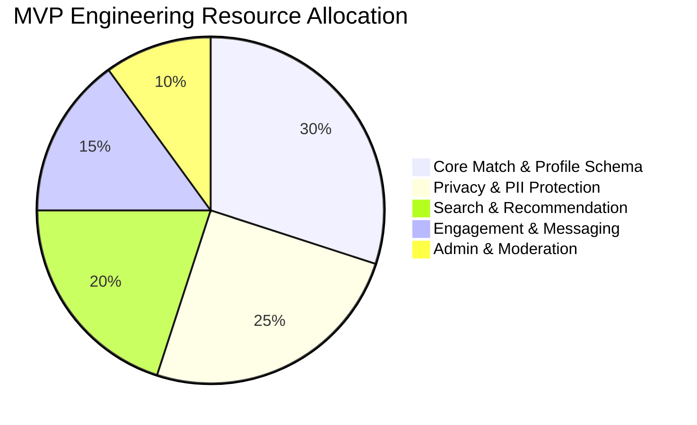

# Feature Scope Matrix: MVP (v1) vs. v2 vs. Later

> **Strategic Scoping Manifesto**: Matrimonial software projects fail when teams attempt to launch with horoscope generation algorithms, real-time video calling, AI astrologer bots, and international payment gateways on Day 1. This matrix provides an uncompromising, battle-tested scope boundary. Every feature cut is defended with architectural and business justifications.

---

## 1. High-Level Scope Allocation Summary

```
Total Identified Feature Universe: 48 Distinct Modules
│
├──  MVP (v1.0) ................... 22 Features (Core Marriage Loop & Safety Baseline)
├──  v2.0 Release ................. 16 Features (Growth, Engagement & Advanced Privacy)
└──  Later / Backlog .............. 10 Features (AI Matchmaker, Native Apps & Complex Video)
```

---

## 2. Granular Scope Matrix with Detailed Justifications

### 2.1 Identity, Registration & Onboarding

| Feature | Scope Tier | Architectural & Business Justification |
| :--- | :---: | :--- |
| **Email + Phone Registration** | **MVP** | Essential foundation. Phone number is mandatory in matrimonial context to deter throwaway bot accounts. |
| **SMS / Email OTP Verification (Stub)** | **MVP** | Zero-cost development stub allows full E2E testing without incurring third-party SMS gateway fees prior to launch. |
| **"Profile Created For" Attribution** | **MVP** | Core cultural requirement. Differentiates matrimonial platform from generic dating apps immediately. |
| **7-Step Progressive Profiling Wizard** | **MVP** | Reduces cognitive drop-off while gathering the required ~30 attributes for valid compatibility matching. |
| **Social Login (Google / Apple)** | **v2** | *Cut Justification*: Social logins frequently lack verified phone numbers, date of birth, and cultural metadata, forcing a post-login onboarding anyway. |
| **DigiLocker / Gov ID Instant Sync** | **v2** | *Cut Justification*: Requires formal commercial enterprise agreements with government aggregators; manual file upload with moderator review suffices for MVP. |
| **Voice-Prompt Onboarding Assistance** | **Later** | *Cut Justification*: High engineering cost for voice recognition; marginal value for early tech-savvy adopters. |

---

### 2.2 Profile Architecture & Media Management

| Feature | Scope Tier | Architectural & Business Justification |
| :--- | :---: | :--- |
| **Complete Attribute Schema (Personal, Education, Career, Family, Diet)** | **MVP** | Mandatory. Without these attributes, partner search and filtering are meaningless. |
| **Photo Upload (MinIO/S3) with EXIF Stripping** | **MVP** | Critical privacy baseline. Strips GPS metadata before storing images. |
| **Dynamic Watermarking on High-Res Photos** | **MVP** | Low engineering overhead (server-side canvas/pillow overlay) with massive anti-scraping psychological deterrence. |
| **Basic Photo Privacy (Public vs. Blurred)** | **MVP** | High priority for privacy-conscious candidates who will not create an account without photo blurring. |
| **AI Selfie Liveness Face-Match** | **v2** | *Cut Justification*: External biometrics APIs (Rekognition/FaceAPI) add recurring SaaS costs. Moderator review of selfie vs. photo suffices for v1. |
| **Kundali / Horoscope PDF Upload** | **v2** | *Cut Justification*: In v1, storing basic Manglik status (`Yes`/`No`/`Don't Know`) handles 90% of filtering needs. PDF parsing is complex. |
| **Automated Astro Chart Calculation** | **Later** | *Cut Justification*: Requires complex Vedic planetary ephemeris libraries; adds niche maintenance overhead without expanding core user base. |

---

### 2.3 Discovery, Search & Matching Engine

| Feature | Scope Tier | Architectural & Business Justification |
| :--- | :---: | :--- |
| **Faceted Filter Search (Age, Height, Religion, City, Education, Income)** | **MVP** | Core user utility. Powered by indexed PostgreSQL B-Tree and GIN columns. |
| **Trigram Fuzzy Search on Bio & Job Titles** | **MVP** | Enabled via PostgreSQL `pg_trgm` with minimal backend complexity; prevents zero-result typos. |
| **Weighted Compatibility Scoring (0 - 100%)** | **MVP** | Differentiates the platform by showing transparent reasons why two users match. |
| **Cached "Today's Recommendations"** | **MVP** | Daily Redis-backed match feed that brings users back to the app every morning. |
| **Saved Search Alerts via Email Digest** | **v2** | *Cut Justification*: Requires background cron worker pipelines and transactional email delivery infrastructure. |
| **Geo-Radius Proximity Search (PostGIS)** | **v2** | *Cut Justification*: City/State string matching covers 95% of matrimonial expectations. Exact GPS proximity is a dating app pattern, not matrimonial. |
| **Machine Learning Collaborative Filtering** | **Later** | *Cut Justification*: Requires substantial interaction datasets (millions of swipes/clicks) to train meaningful latent embeddings. |

---

### 2.4 Engagement, Communication & Contact Reveals

| Feature | Scope Tier | Architectural & Business Justification |
| :--- | :---: | :--- |
| **Express Interest Funnel (`Pending`, `Accepted`, `Declined`)** | **MVP** | The single most critical interaction mechanism on the platform. |
| **Daily Interest Rate Limiter (5/day for Free)** | **MVP** | Anti-spam gate; prevents mass scraping and creates immediate monetization incentive. |
| **Private Shortlisting / Bookmarking** | **MVP** | Basic CRUD operation enabling users to save candidates for family discussion. |
| **In-App 1-on-1 Text Messaging** | **MVP** | Essential for connected members to converse without immediately sharing phone numbers. |
| **Masked Contact Number Reveal with Credit Deduction** | **MVP** | Primary revenue driver of the business model. |
| **Full-Duplex Audio / Video Calling** | **v2** | *Cut Justification*: WebRTC STUN/TURN infrastructure and media servers (LiveKit/Janus) are expensive and complex to maintain. Text chat suffices for early traction. |
| **WhatsApp Direct Deep-Linking** | **v2** | *Cut Justification*: Needs phone reveal verification first; simple copy-to-clipboard satisfies v1. |
| **Virtual Family Meeting Rooms (Multi-Party Video)** | **Later** | *Cut Justification*: High latency and coordination overhead; families prefer Zoom/Google Meet once contact numbers are exchanged. |

---

### 2.5 Monetization, Plans & Payments

| Feature | Scope Tier | Architectural & Business Justification |
| :--- | :---: | :--- |
| **Plan Catalog (Free, Gold, Platinum)** | **MVP** | Sets up subscription database models and entitlement check middlewares. |
| **Mock / Sandbox Payment Checkout Flow** | **MVP** | Allows full simulation of tier upgrades, credit allotments, and invoice receipts in dev/staging. |
| **Stripe / Razorpay Production Webhooks** | **v2** | *Cut Justification*: Payment gateway merchant onboarding requires registered business tax IDs (GST/EIN), which is decoupled from platform code validation. |
| **Automated Recurring Billing (SaaS Subscriptions)** | **v2** | *Cut Justification*: Matrimonial purchases are typically one-off term passes (3 months / 6 months) rather than indefinite recurring SaaS. |
| **Dynamic Surge Pricing & Personalized Discounts** | **Later** | *Cut Justification*: Optimization feature for platforms with tens of thousands of daily paying users. |

---

### 2.6 Trust, Safety & Administration

| Feature | Scope Tier | Architectural & Business Justification |
| :--- | :---: | :--- |
| **Bidirectional Block Feature** | **MVP** | Absolute legal and ethical safety requirement. Instantly severs all contact and visibility. |
| **User Incident Reporting with Categories** | **MVP** | Essential to capture feedback on abusive or fraudulent accounts. |
| **Role-Based Moderator Portal** | **MVP** | Admins and moderators need a back-office UI to review reports, suspend accounts, and inspect photos. |
| **Permanent Account Deletion (GDPR/DPDP)** | **MVP** | Regulatory compliance requirement; protects user privacy if they marry or leave the platform. |
| **Automated Fraud Detection (Anomaly Scoring)** | **v2** | *Cut Justification*: Rule-based thresholding (e.g., > 10 reports triggers auto-freeze) is sufficient for early scale before ML models are trained. |
| **Automated Government ID OCR Parsing** | **v2** | *Cut Justification*: High failure rate across varied regional ID cards; manual visual inspection by moderators is more reliable in early phases. |

---

## 3. Summary of MVP Trade-Off Philosophy



1. **Depth over Breadth**: We build a rock-solid, bug-free, fully responsive multi-step profile builder, faceted search engine, and messaging channel rather than a dozen half-baked gimmicks.
2. **Safety First**: Features related to PII masking, photo privacy, and blocking are strictly classified as **MVP non-negotiables**.
3. **Decoupled Gateway Architecture**: All payment and SMS notification systems are engineered behind interface contracts (Strategy Pattern), allowing stub implementations in MVP and seamless plug-and-play production adapters in v2.
